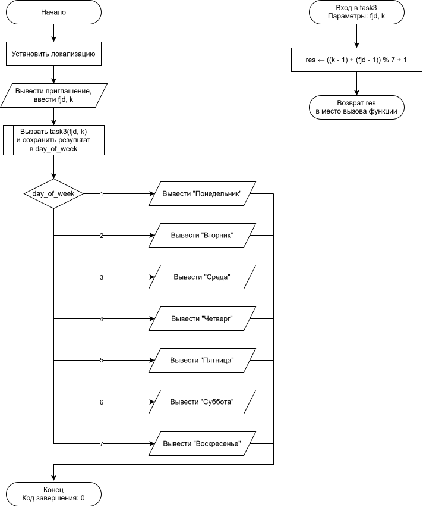

# Домашнее задание

## Условие задачи
Дано целое число k, определить каким днем недели является k-й день невисокосного года, в котором 1 января приходиться на заданный заранее день недели.

---

## 1. Алгоритм и блок-схема

### Алгоритм
1. Начало функции. Получение целых чисел fjd (код дня недели 1 января от 1 до 7) и k (порядковый номер дня в году от 1 до 365) в качестве параметров.
2. Вычисление смещения относительно начала года: к количеству прошедших дней с начала года (k - 1) прибавить смещение первого дня недели (fjd - 1).
3. Взять остаток от деления полученной суммы на количество дней в неделе ((k - 1) + (fjd - 1)) % 7.
4. Прибавить 1 к полученному остатку, чтобы перевести результат в диапазон от 1 (понедельник) до 7 (воскресенье).
5. Завершить выполнение функции и вернуть итоговое значение в main через оператор return.
6. Конец функции.

### Блок-схема

[]()
## 2. Реализация программы
```c
if (scanf("%d %d", &fjd, &k) == 2) {
    int day_of_week = task3(fjd, k);
    
    printf("%d-й день года - это ", k);
    switch (day_of_week)
    {
        case 1: printf("Понедельник\n"); break;
        case 2: printf("Вторник\n"); break;
        case 3: printf("Среда\n"); break;
        case 4: printf("Четверг\n"); break;
        case 5: printf("Пятница\n"); break;
        case 6: printf("Суббота\n"); break;
        case 7: printf("Воскресенье\n"); break;
    }
}

int task3(int fjd, int k)
{
    return ((k - 1) + (fjd - 1)) % 7 + 1; 
}
```
## 3. Результат работы программы
Ввод: 3 32

Вывод: 32-й день года - это Суббота
## 4. Информация о разработчике
Гаврилова Анна, бИД-262
